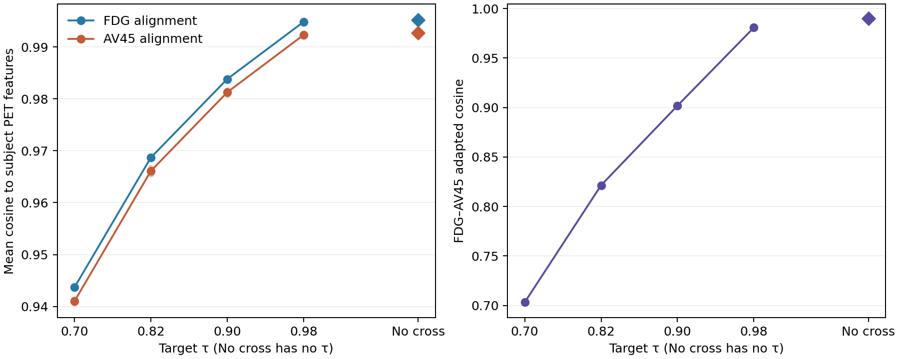

# R2-15：Adapter 层 τ 敏感性与跨示踪剂项消融

## 结论

五组设置均完成两折独立 Adapter 优化。τ 从 0.70 增至 0.98 时，适配后 FDG/AV45 向量的余弦均值从 0.7032 增至 0.9807，两种 tracer 的训练折文本–PET 对齐余弦也随之上升。完全移除跨示踪剂项的 T000 得到跨 tracer 余弦 0.9897。**这些是表示层测量值；本实验没有训练或推理生成器，不能判断 PET 合成质量、下游分类效果或临床性能，也不能据此选定最优 τ。**

## 方法与输入身份

- 使用 E1 `reports/e1_stage01_20261017/config.json` 的两折及 QC 排除规则：1,857 人中排除 `016_S_4952`，有效 1,856 人，每折训练/留出各 928 人。折 1 训练 PET 特征数为 FDG 795、AV45 687，留出分别为 802、677；折 2 互换。仅训练折 PET 特征参与 Adapter 拟合。
- 冻结并复用 E1 原始 BiomedCLIP tracer 文本向量（2×512，SHA-256 `eaa3c76e…cbb28e`）和既存逐人 PET 特征（FDG `1206cc6a…568fa1`、AV45 `029c1a4f…fad33f`）。已核对缓存 SHA、PTID 唯一性、特征与原缓存的绑定及折内名单；没有重新提取特征或加载 PET 影像。
- 两个独立 affine adapter 各有一个标量 scale 和一个 512 维 bias；先归一化原始文本及逐人 PET 特征，再归一化适配向量。与 E1 相同，优化损失为 `−mean_cos(FDG) − mean_cos(AV45) + λ·(cos(z_FDG,z_AV45)−τ)²`。这里 `mean_cos` 是对该 tracer **每名训练受试者**的余弦取均值；`alignment_loss` 在结果表中保留实际代码使用的负号。
- 五组分别为 T070 `(τ=.70, λ=100)`、T082 `(.82, 100)`、T090 `(.90, 100)`、T098 `(.98, 100)`、T000 `(τ=N/A, λ=0)`。T000 完全删去跨项，并非 τ=0。每折每组均从同一初始值独立拟合：scale 全为 1、bias 为 `0.01×N(0,1)`；折 1/2 种子分别为 43/44。优化器为 Adam、学习率 `1e-3`、5,000 次更新、CPU float32。结果指标均在**最后一次更新之后**从最终参数重算。
- 两折留出 alignment 只在优化完成后计算，不用于梯度、超参数选择或模型选择。10 组 checkpoint、embedding、逐 100 步日志和输入身份收据位于 `runs/`。每折五组初始参数 SHA 完全相同；T082 两折新 embedding 与 E1 既存 0.82 embedding 逐元素完全一致。E1 旧收据的 `loss` 是最后一次参数更新前的值，因此与这里更新后的 `total_loss` 不直接相等。

## 实测结果

训练折余弦、损失及实际 τ 偏差如下；完整精度及留出折指标见 [`results.csv`](results.csv)。`cross_term_loss` 是已乘 λ 的损失，T000 为 0；T000 的 τ 偏差不适用。

| 组别 | 折 | FDG 对齐 | AV45 对齐 | 跨 tracer 余弦 | 对齐损失 | 跨项损失 | 总损失 | 实际余弦−τ |
|---|---:|---:|---:|---:|---:|---:|---:|---:|
| T070 | 1 | 0.943913 | 0.940601 | 0.704320 | −1.884514 | 0.001866 | −1.882648 | +0.004320 |
| T070 | 2 | 0.943467 | 0.941433 | 0.702110 | −1.884900 | 0.000445 | −1.884455 | +0.002110 |
| T082 | 1 | 0.968727 | 0.965537 | 0.821290 | −1.934264 | 0.000166 | −1.934098 | +0.001290 |
| T082 | 2 | 0.968653 | 0.966673 | 0.821548 | −1.935326 | 0.000240 | −1.935086 | +0.001548 |
| T090 | 1 | 0.983977 | 0.980828 | 0.901897 | −1.964805 | 0.000360 | −1.964446 | +0.001897 |
| T090 | 2 | 0.983650 | 0.981699 | 0.901748 | −1.965349 | 0.000305 | −1.965043 | +0.001748 |
| T098 | 1 | 0.995129 | 0.992017 | 0.980703 | −1.987146 | 0.000049 | −1.987097 | +0.000703 |
| T098 | 2 | 0.994545 | 0.992615 | 0.980647 | −1.987160 | 0.000042 | −1.987118 | +0.000647 |
| T000 | 1 | 0.995509 | 0.992398 | 0.990014 | −1.987906 | 0 | −1.987906 | N/A |
| T000 | 2 | 0.994867 | 0.992938 | 0.989351 | −1.987805 | 0 | −1.987805 | N/A |

| 组别 | 折 1 留出 FDG / AV45 对齐 | 折 2 留出 FDG / AV45 对齐 |
|---|---:|---:|
| T070 | 0.943179 / 0.942605 | 0.944105 / 0.939331 |
| T082 | 0.968007 / 0.967137 | 0.969295 / 0.964996 |
| T090 | 0.983274 / 0.982060 | 0.984289 / 0.980400 |
| T098 | 0.994462 / 0.992662 | 0.995173 / 0.991923 |
| T000 | 0.994850 / 0.992912 | 0.995492 / 0.992371 |

跨折描述性均值及相对 T082 的变化见 [`summary.csv`](summary.csv)。T082 的 FDG/AV45 训练对齐均值为 0.968690/0.966105，跨 tracer 余弦均值为 0.821419。相对 T082，T070 的两种对齐各下降约 0.0250，跨 tracer 余弦下降 0.1182；T090 的两种对齐各上升约 0.0151，跨 tracer 余弦上升 0.0804；T098 各上升约 0.0262，跨 tracer 余弦上升 0.1593；T000 各上升约 0.0265，跨 tracer 余弦上升 0.1683。这里只做两折描述，不报告显著性或置信区间。



## 科学解释与边界

本实验直接观察到跨项可以控制两个适配向量的**角度接近程度**：在 τ=0.82 时，跨 tracer 余弦约为 0.821；移除跨项后约为 0.990。较低 τ 保留更大的向量角度差，但与训练 PET 特征的平均余弦也较低；较高 τ 或无跨项取得更高的图文特征对齐，同时两个 tracer 向量更接近。这说明跨项在表示层产生了可测的权衡，**不证明**更高或更低的余弦会改善生成图像，也不证明 τ=0.82 是最优值。

原稿的 `sim ≥ τ` 是设计简述；本实验对应实际实现的**目标相似度平方惩罚**，高于目标同样受罚。T098 仍受该惩罚，不等同于 T000。当前 Full/Only-tracer 实验没有使用 Adapter，其权重和结果不属于本表。两折使用 E1 的队列、QC 与特征；不能将这里的 Adapter 指标直接移植为原稿历史生成实验的性能证据。

## 可用于 R2-15 中文回复的事实摘要

我们补充了固定两折、相同原始文本/PET 特征及初始化的 Adapter 层敏感性分析，比较 τ=0.70、0.82、0.90、0.98（跨项权重均为 100）以及完全去除跨项。实际优化采用跨示踪剂余弦与目标 τ 之差的平方软惩罚。τ=0.82 时，两折适配向量间的余弦为 0.8213 和 0.8215；去除跨项后为 0.9900 和 0.9894。提高 τ 时，两种 tracer 的文本–PET 特征对齐余弦和跨 tracer 余弦均上升，显示该项在共享对齐与向量角度差之间产生可测的表示层权衡。此次分析未训练或评估 PET 生成器，因此不据此宣称某个 τ 的生成效果或临床效果最优。

## 复现

在仓库根目录运行：

```sh
CUDA_VISIBLE_DEVICES='' PYTHONDONTWRITEBYTECODE=1 \
  /mnt/ssd/linshuijin/miniconda3/envs/xiaochou/bin/python -B \
  experiments/r2_15_tau_adapter_ablation/run.py preflight
```

配置见 [`config.json`](config.json)。拟合入口为 `run.py fit --group <ID> --fold <1|2>`，完成全部十组后运行 `run.py summarize`。入口拒绝覆盖已有组输出；若需重做，使用新的独立实验身份保存结果和失败记录。
