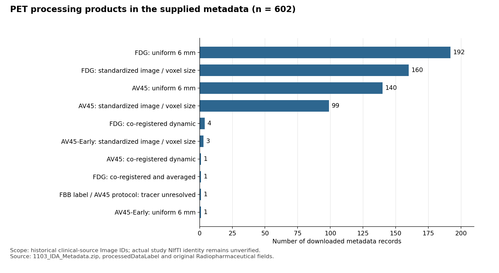

# 这批 IDA metadata 能确认采集与处理信息，但尚不能计算实际 MRI–PET 间隔

本次检查用户下载的 `source_archive/1103_IDA_Metadata.zip`，并逐 Image ID 关联此前恢复的 1857 条临床源记录。**可用的详细 XML 有 1749 条：MRI 1147、PET 602。它们提供采集日期、ADNI Series ID、父影像 ID、处理步骤、原始采集协议及扫描仪信息。** 缺少详细信息的条目按用户要求跳过，未追补、替换或推算。

这批请求每位被试只有一条主影像记录，详细 XML 也没有同一人同时具备 MRI 和 PET 主记录，因此**当前可计算的 MRI–PET 配对数为 0，间隔为无法计算，并非 0 天**。此外，临床源记录的 Image ID 尚未证实为项目实际 NIfTI 的来源。

## 对当前问题能回答到哪一步

| 需要的信息 | 此 ZIP 的证据 | 当前结论 |
|---|---|---|
| MRI / PET 采集日期 | 主序列 `dateAcquired`，1749 条均有 | 能确定本批主记录的采集日期 |
| MRI–PET 间隔 | 每位被试仅有一条主影像；父影像协议没有另一个模态的可对应采集日期 | 尚不能计算实际配对间隔 |
| PET tracer | `originalRelatedImage/protocolTerm` 中的 `Radiopharmaceutical`，602 条均有 | FDG 357、AV45 字段值 245；其中 1 条与 FBB 处理标签冲突，保留未决 |
| ADNI 上游处理 | `processedDataLabel`、`provenanceDetail` 的 process / package / program / version / params | 能逐影像恢复处理版本和步骤，不能认定所有条目使用同一版本 |
| 扫描仪与采集/重建参数 | 原始父影像协议中的厂家、型号、MRI 场强、PET 重建和校正字段等 | 能描述本批元数据的多扫描仪差异；不能据此证明差异已消除 |
| 当前模型输入实际用了哪次影像 | 现有 ID 来自临床资料取首行，尚无文件级来源映射 | 仍未确认；本批参数不能直接推广为实际全部输入影像参数 |

## 采集时间与配对的具体限制

- MRI 主记录的 `dateAcquired` 范围：**2005-09-01 至 2017-07-20**。
- PET 主记录的 `dateAcquired` 范围：**2006-01-06 至 2023-03-23**。
- 详细 XML 的 1749 个不同 Image ID 属于 1749 个不同被试；没有同被试 MRI/PET 主记录组合。
- `relatedImage` 给出了派生自哪些 Image ID；`originalRelatedImage` 给出父影像协议。它们没有为缺失的另一模态提供可核验的采集日期，不能用主影像日期代替父影像或其他访视日期。
- `creationDate` 与处理步骤 `timestamp` 多处出现 `2000-01-01` 占位值，且其含义本就不是采集日期。本次间隔检查只认主序列 `dateAcquired`，不使用这些字段。

因此不能按不同被试的日期相减、按年龄倒推日期，或把不同临床访视任意配成一对。后续实际间隔需要同一被试实际使用的 MRI 和 PET 各自 Image ID、采集日期及来源对应关系；这与本次跳过少量缺失下载记录是不同的证据问题。

## Tracer：已有明确字段，同时存在一个内部冲突

602 条 PET 的原始采集协议中：

| Radiopharmaceutical 原值 | 记录数 | 解释 |
|---|---:|---|
| `18F-FDG` | 357 | 本批协议明确标记 FDG |
| `18F-AV45` | 245 | 244 条未发现产品标签的明确冲突；另 1 条见下方 |

需要保留的具体差异：

1. **`116_S_6133 / I1563763 / S1118586`**：2022-03-29，产品标签是 `FBB Coreg, Avg, Standardized Image and Voxel Size`，但原始父影像 `I1561994` 的描述为 `PET BRAIN AC AV45`，`Radiopharmaceutical=18F-AV45`。这是一条元数据内部不一致，不能单凭一个字段决定它究竟是 florbetapir 还是 florbetaben，更不能据此断言项目实际使用了 FBB。
2. **4 条 AV45-Early**：`I1297136`、`I1297156`、`I1558966`、`I1620330`。这些条目的步骤明确写为 `Average Frames 4 - 11 (45sec-6min)`。这一帧平均窗口应单独记录，不能把它们与其他 AV45 产品笼统归为同一采集/处理协议。是否为当前真实输入仍待文件映射。

上述具体 XML 成员及原值均保存在 [metadata_findings.csv](metadata_findings.csv)，未为冲突条目擅自选定 tracer。

## PET 上游处理：这批记录全部是派生产品，版本并不一致

602 条详细 PET XML 的 `processingInstitution` 均为 `University of Michigan`，`imageType` 均为 `image volume`。主要产品分布如下，计数单位为本次下载的主 Image ID，不是论文全队列 PET 数量。

| processedDataLabel | 数量 |
|---|---:|
| Coreg, Avg, Std Img and Vox Siz, Uniform 6mm Res | 192 |
| Coreg, Avg, Standardized Image and Voxel Size | 160 |
| AV45 Coreg, Avg, Std Img and Vox Siz, Uniform 6mm Res | 140 |
| AV45 Coreg, Avg, Standardized Image and Voxel Size | 99 |
| Co-registered Dynamic | 4 |
| AV45-Early Coreg, Avg, Standardized Image and Voxel Size | 3 |
| Co-registered, Averaged | 1 |
| AV45 Co-registered Dynamic | 1 |
| FBB Coreg, Avg, Standardized Image and Voxel Size | 1 |
| AV45-Early Coreg, Avg, Std Img and Vox Siz, Uniform 6mm Res | 1 |

图中的短标签结合产品名称与原始药物字段，其中 FBB/AV45 冲突单独列出。精确原标签映射和计数见 [pet_product_figure_data.csv](pet_product_figure_data.csv)。

步骤字段进一步支持以下描述：

- 常见步骤包括 `Smooth`、`Calculate Coregistration`、`Apply Coregistration`、`Average Frames`、`AC-PC Orient Baseline`、`Standardize to Baseline`、`Intensity Normalization`，并记录了 NeuroStat / XIDA 等程序及版本。不同产品并非全都包含全部步骤。
- **333 条**产品名称明确有 `Uniform 6mm Res`，且这 333 条均有 `Variable Smooth` 步骤。其余 269 条没有该标签，不能据此宣称本批全部 PET 均已统一至 6 mm，也不能把原始协议的重建卷积核等同于派生产品最终分辨率。
- **240 条**明确有 `Intensity Normalization to Cerebellar Gray Matter`。这支持这 240 个查询条目的上游流程包含小脑灰质归一化；其中包含上述 FBB/AV45 冲突条目。
- FDG 的 357 条中，352 条有通用 `Intensity Normalization`，该步骤没有写出参考区；其余 5 条为动态或仅平均的产品。**不能从这些 XML 确认 FDG 使用 pons 作为参考区。**
- 4 条 AV45-Early 的强度归一化只写通用名称；1 条 AV45 动态产品没有上述强度归一化步骤。不能将 240 条的参考区记录推广到全部 245 条 AV45 字段记录。

上述处理属于这些 ADNI 产品的上游记录，不是项目自己的去颅骨、MRI 配准、裁剪或 min–max 缩放记录。即使某个查询产品有参考区归一化，也不能在当前 NIfTI 来源尚未确定时将项目全部 ROI 值改称 SUVR。

## 多扫描仪差异：有直接参数，尚不能评价影响是否消除

厂家、型号、几何和重建信息取自**主序列对应的原始父影像协议**，不是派生产品的当前输出几何。相同主影像有多个参数相同父影像时，图像级汇总只计一次；额外参考影像的协议另列，避免把参考图的扫描仪误算为本次扫描仪。

| 参数 | MRI（1147 条） | PET（602 条） |
|---|---|---|
| siteKey 数量 | 61 | 63 |
| 原始厂家字符串 | SIEMENS 584；GE MEDICAL SYSTEMS 417；Philips Medical Systems 145；Philips Healthcare 1 | 9 种原始字符串，含 GE/GEMS、Siemens/CTI/Siemens ECAT、Philips 等写法 |
| 非空原始型号字符串种类 | 22 | 42 |
| 场强原值 | `3.0`：703；`1.5`：292；`1.494`：152 | 未提供此 MRI 专属字段 |
| 重建算法字符串种类 | 本批 MRI 协议未提供 PET 式重建字段 | 24 种非空值，另 8 条为空 |

PET 可见 `3D IR`、`VPHD`、`OSEM3D 4i21s`、`OSEM3D 4i24s`、`LOR-RAMLA` 等不同重建字段，并保留卷积核、帧数、像素间距、层厚以及衰减、散射、随机和衰变校正信息。原始厂家/型号字符串存在别名；没有把“9 个字符串”解释为 9 家实际厂家，也没有进行未经核实的型号合并。

这些信息足以形成扫描仪/重建协议清单。仅有参数和部分统一平滑步骤，不足以证明项目完成了 ComBat、其他统计 harmonization 或消除了扫描仪效应；本次也未进行这些新分析。

## MRI 类型再次说明临床源 Image ID 与实际输入还需对应

本批 1147 条 MRI 产品中：

- **382 条 `imageType=mask`**，765 条 `imageType=image volume`。常见产品包括 GradWarp / B1 Correction / Mask、MT1 / N3m，以及空间标准化产品。
- `registration` 包括 native 1075、Colin27 59、MNI152 7、AC-PC 6，不能概括为同一空间状态。
- `012_S_0637 / I437890` 为 `EPI current corrected image`，步骤含扩散张量拟合等；其额外参考图还带有其他原始协议。本次明确保留源与参考上下文，未将其混为同一次 T1 扫描。

这并不证明项目实际输入了 382 个 mask 或上述 EPI 产品。它证明了**临床资料按被试取首条源记录的 ID，不能自动作为实际 T1/PET 文件身份**。本批 metadata 能为这些查询 ID 提供可靠字段，但实际文件层面的匹配仍是下一步关键。

## 输出与核验

- [image_metadata.csv](image_metadata.csv)：1749 条详细主记录，采集日期、Series ID、处理标签、原始协议字段及原始 ZIP 成员定位。
- [original_protocols.csv](original_protocols.csv)：1753 条原始/参考影像协议记录，保留 original Image ID 和 XML 上下文。
- [processing_steps.csv](processing_steps.csv)：7726 个处理步骤，保留 package / program / version / params / timestamp 等原字段。
- [image_relations.csv](image_relations.csv)：派生影像到相关 Image ID 的显式关系；没有擅自给相关影像补日期。
- [mri_pet_pairing_check.csv](mri_pet_pairing_check.csv)：逐被试配对可用性，间隔留空并注明不可计算。
- [metadata_findings.csv](metadata_findings.csv)：FBB/AV45 冲突、AV45-Early、mask 和 EPI 条目。
- [metadata_coverage.csv](metadata_coverage.csv)：只记录已有、仅 ID 指针或缺失状态；按用户要求未追补。
- [summary.json](summary.json)、[archive_member_manifest.json](archive_member_manifest.json)：输入/脚本哈希、各字段计数及 ZIP 成员哈希。
- [inspect_metadata.py](inspect_metadata.py)、[plot_pet_products.py](plot_pet_products.py)：复现本次提取、汇总和图件；原 ZIP 未解压改写。

ZIP 共 3592 个 XML：1843 个轻量 ID 指针、1749 个详细 XML。详细条目全部与请求 ID 的 Subject ID、Modality 相符；轻量指针与详细 XML 的 Series ID、被试及日期目录也一致。详细 XML 没有重复主 Image ID；全部采集日期格式通过检查。字段不足的条目已跳过，不作为影像异常或被试排除依据。

以上结论适用于本次查询 ID 的 metadata。正式稿件若要报告“实际用于生成/分类的 MRI–PET 时差、tracer 与协议”，还需先完成实际 NIfTI 的 Image ID 对应；本次没有修改稿件、队列或任何实验输入。
