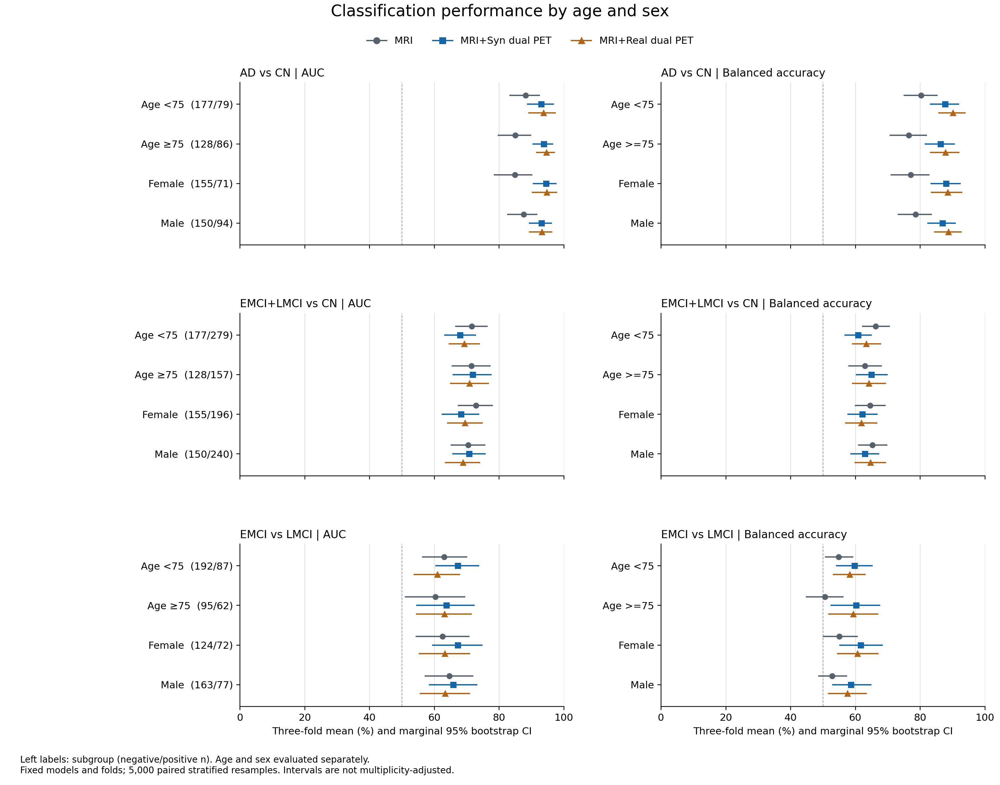

# R2-16：结果解读与可用回复草稿

已完成年龄、性别分别分层的分类性能评价。结果支持AD/CN中合成双PET相对MRI的分层分类增益，但不支持三个任务、所有亚组统一获益，也不能证明人口学混杂已经消除。

## 已核实结果

- **AD/CN：** MRI+Syn双PET在四个亚组的AUC为93.02%–94.55%，balanced ACC为86.33%–88.02%。相对MRI的balanced ACC增益在四个亚组均为正，且四个边际95%区间均高于0；AUC增益点估计也均为正，但＜75岁亚组的AUC差值区间跨0。此处不将边际区间结果写成经过多重比较校正的确认性结论。
- **EMCI+LMCI/CN：** 未观察到一致增益。＜75岁亚组的balanced ACC差值为-5.44 [-10.55, -0.53]个百分点；该亚组MRI+Syn双PET的SEN为79.11%、SPE为42.57%，应保留低特异度这一限制。其余年龄/性别亚组的balanced ACC差值区间均跨0。
- **EMCI/LMCI：** 四个亚组的AUC和balanced ACC增益点估计均为正，但AUC差值区间均跨0；只有≥75岁亚组的balanced ACC区间高于0（+9.64 [+1.23, +18.05]个百分点）。不能据此宣布年龄交互作用；女性、男性的LMCI敏感度仍仅为49.49%、36.69%。
- **Syn与Real双PET：** 三任务、四个亚组的AUC及balanced ACC配对差值区间均跨0，不能推断等效、非劣效或无差异。

下表是MRI+Syn双PET相对MRI的balanced ACC差值，单位为百分点，括号为未作多重比较校正的边际95%条件性bootstrap CI。

| 任务 | ＜75岁 | ≥75岁 | 女性 | 男性 |
|---|---:|---:|---:|---:|
| AD vs CN | +7.45 [+1.09, +13.91] | +9.91 [+3.37, +16.34] | +10.97 [+4.30, +17.82] | +8.30 [+2.11, +14.50] |
| EMCI+LMCI vs CN | -5.44 [-10.55, -0.53] | +2.03 [-4.04, +8.13] | -2.47 [-7.99, +3.11] | -2.37 [-7.77, +3.06] |
| EMCI vs LMCI | +4.85 [-1.05, +10.96] | +9.64 [+1.23, +18.05] | +6.58 [-0.61, +13.72] | +5.79 [-0.65, +12.29] |

## 解释边界

本次在固定三折、固定模型的测试预测上评价记录年龄与性别的分层表现。分层可显示亚组内表现及增益方向，但年龄仍在档内变化，年龄与性别也未相互调整；临床评分和其他变量的混杂仍可能存在。没有进行亚组交互作用检验；不能通过比较不同亚组区间是否跨0推断收益差异。

现有导出没有EXAMDATE/VISCODE，无法核实人口学记录与MRI采集同次访视。年龄字段在observed与metadata表逐值相同、906名测试受试者均有年龄/性别，但这不建立影像当日年龄的身份。应在方法和回复中明确这个缺口。

## R2-16英文回复草稿

> We performed an additional age- and sex-stratified analysis using the existing three-fold held-out test predictions. Age was divided at 75 years, and female and male participants were evaluated separately. All test participants could be linked to the available demographic records without age or sex imputation. We retained the original test folds, checkpoints, and classification threshold. Within each subgroup, metrics were calculated separately in each fold and then averaged equally across the three folds; AUC was not calculated by pooling scores from different fold models. Marginal 95% confidence intervals were obtained from 5,000 paired bootstrap resamples within fold, subgroup, and true-class strata, sharing the sampled participants across input conditions.

> For AD versus CN, the balanced-accuracy differences between MRI plus synthetic dual-tracer PET and MRI alone were +7.45 [+1.09, +13.91] percentage points below age 75, +9.91 [+3.37, +16.34] at age 75 or older, +10.97 [+4.30, +17.82] in female participants, and +8.30 [+2.11, +14.50] in male participants. These estimates suggest that the observed AD/CN gain was not confined to one of these broad demographic subgroups. Results did not show consistent gains for EMCI+LMCI versus CN: below age 75, the balanced-accuracy difference was -5.44 [-10.55, -0.53] percentage points. For EMCI versus LMCI, subgroup estimates were imprecise; the balanced-accuracy difference at age 75 or older was +9.64 [+1.23, +18.05] percentage points, while the corresponding intervals in the other subgroups included zero. We do not interpret these patterns as evidence of an age or sex interaction. Differences between synthetic and real dual-tracer PET in subgroup AUC and balanced accuracy remained uncertain and do not establish equivalence.

> This analysis quantifies performance within broad demographic strata rather than establishing that demographic confounding has been eliminated. The intervals are conditional on the fitted models and fixed folds and are not adjusted for multiple comparisons. Age and sex were stratified separately, and residual imbalance within strata and confounding by clinical scores or other variables may remain. Furthermore, the recovered demographic export lacks visit dates, so alignment of recorded age with the MRI acquisition visit cannot be verified. This analysis therefore provides a limited subgroup assessment and does not by itself resolve the separate concern about the provenance and possible imputation of conditioning scores.

以上为独立草稿，尚未插入稿件或正式回复信；不写成已在正文某节/某表完成修改。

## 可插入方法的文字

An exploratory subgroup analysis was performed using recorded age (<75 or ≥75 years) and sex (female or male), evaluated separately. The original outer-test assignments and prediction threshold of 0.5 were retained. AUC, balanced accuracy, accuracy, sensitivity, and specificity were calculated within each fold and subgroup and then averaged equally over the three folds. Marginal 95% percentile confidence intervals were estimated with 5,000 bootstrap resamples within fold, subgroup, and true-class strata, pairing participants across input conditions. These intervals were conditional on the fitted models and fixed partitions and were not adjusted for multiple comparisons. Visit-date alignment of the available demographic records with MRI acquisition could not be verified.

## 交付与复核

- [完整统计报告](REPORT.md)：七输入、五指标、两项预先指定比较及全部限制。
- [LaTeX补表片段](supplementary_tables.tex)：三任务重点三输入的AUC和balanced ACC及人数，可供人工插入。
- [可编辑SVG图](subgroup_performance.svg)、[PDF图](subgroup_performance.pdf)、[PNG预览](subgroup_performance.png)。
- [验证记录](validation.json)：原63折指标和21组三折均值/SD一致；315个点估计及630个抽样指标经独立sklearn核对。

