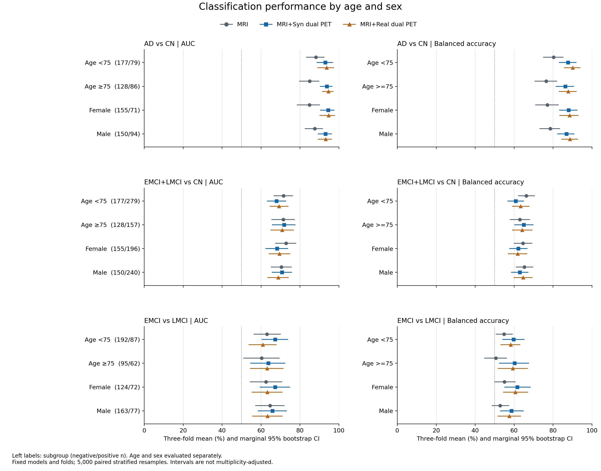

# R2-16：年龄、性别分层分类性能评价

本分析使用现有三折 outer-test 预测；年龄与性别分别分层，不交叉细分。未训练、推理、重新选择 checkpoint、校准概率或调整阈值。

## 数据覆盖与分层

1,647 条任务–受试者记录对应 906 名唯一受试者；受试者可参与不同任务，各任务独立评价，不合并推断。11,529 条七输入预测均与固定测试名单逐项对应。年龄、性别无缺失，不作插补。

| 任务 | 亚组 | 总人数 | 阴性 | 阳性 |
|---|---|---:|---:|---:|
| AD vs CN | All | 470 | 305 | 165 |
| AD vs CN | Age <75 | 256 | 177 | 79 |
| AD vs CN | Age >=75 | 214 | 128 | 86 |
| AD vs CN | Female | 226 | 155 | 71 |
| AD vs CN | Male | 244 | 150 | 94 |
| EMCI+LMCI vs CN | All | 741 | 305 | 436 |
| EMCI+LMCI vs CN | Age <75 | 456 | 177 | 279 |
| EMCI+LMCI vs CN | Age >=75 | 285 | 128 | 157 |
| EMCI+LMCI vs CN | Female | 351 | 155 | 196 |
| EMCI+LMCI vs CN | Male | 390 | 150 | 240 |
| EMCI vs LMCI | All | 436 | 287 | 149 |
| EMCI vs LMCI | Age <75 | 279 | 192 | 87 |
| EMCI vs LMCI | Age >=75 | 157 | 95 | 62 |
| EMCI vs LMCI | Female | 196 | 124 | 72 |
| EMCI vs LMCI | Male | 240 | 163 | 77 |

正类分别为 AD、EMCI+LMCI、LMCI。年龄界值固定为 75 岁，不根据分层性能修改；女性/男性按源表 F/M。各折亚组两类均存在，最小类别人数为18。

## 重点三组的分层性能

数值为三折等权均值百分数 [边际95% bootstrap CI]；三折 sample SD 另存 CSV，不当作 CI。完整七输入、五指标见 [summary_metrics.csv](summary_metrics.csv)。

### AD vs CN

| 亚组 | 输入 | AUC | balanced ACC | ACC | SEN | SPE |
|---|---|---:|---:|---:|---:|---:|
| Age <75 | MRI | 88.17 [83.22, 92.56] | 80.27 [74.84, 85.42] | 82.21 [77.63, 86.58] | 75.49 [65.81, 84.54] | 85.04 [79.85, 90.00] |
| Age <75 | MRI+Syn dual PET | 93.02 [88.60, 96.90] | 87.71 [83.01, 91.96] | 89.43 [85.59, 92.96] | 83.09 [74.75, 90.81] | 92.33 [88.37, 96.11] |
| Age <75 | MRI+Real dual PET | 93.69 [88.98, 97.46] | 90.10 [85.63, 93.98] | 92.19 [88.83, 95.16] | 84.68 [76.25, 92.03] | 95.52 [92.21, 98.31] |
| Age >=75 | MRI | 84.99 [79.58, 89.90] | 76.42 [70.59, 82.07] | 76.84 [71.23, 82.28] | 74.31 [65.07, 83.33] | 78.53 [71.36, 85.28] |
| Age >=75 | MRI+Syn dual PET | 93.83 [90.34, 96.73] | 86.33 [81.41, 90.75] | 86.27 [81.50, 90.67] | 87.29 [79.86, 93.68] | 85.36 [78.97, 91.14] |
| Age >=75 | MRI+Real dual PET | 94.55 [91.36, 97.17] | 87.74 [83.01, 92.14] | 88.70 [84.38, 92.69] | 83.06 [74.58, 90.49] | 92.43 [87.56, 96.91] |
| Female | MRI | 84.85 [78.40, 90.29] | 77.05 [70.86, 82.84] | 80.01 [74.76, 84.90] | 70.87 [60.01, 80.80] | 83.23 [77.16, 88.96] |
| Female | MRI+Syn dual PET | 94.55 [90.43, 97.73] | 88.02 [83.17, 92.52] | 88.94 [84.57, 92.91] | 85.22 [76.93, 92.83] | 90.83 [86.13, 95.08] |
| Female | MRI+Real dual PET | 94.70 [90.12, 97.88] | 88.45 [83.25, 93.04] | 91.15 [87.20, 94.68] | 82.44 [72.73, 90.77] | 94.45 [90.37, 97.91] |
| Male | MRI | 87.54 [82.46, 91.80] | 78.59 [73.01, 83.57] | 79.10 [73.79, 84.00] | 76.84 [67.80, 84.99] | 80.33 [73.78, 86.33] |
| Male | MRI+Syn dual PET | 93.07 [89.24, 96.32] | 86.89 [82.16, 91.03] | 87.30 [82.81, 91.02] | 86.59 [78.93, 93.28] | 87.20 [81.70, 92.34] |
| Male | MRI+Real dual PET | 93.15 [89.20, 96.41] | 88.74 [84.24, 92.83] | 90.17 [86.46, 93.85] | 84.23 [76.26, 91.33] | 93.25 [89.01, 96.83] |

### EMCI+LMCI vs CN

| 亚组 | 输入 | AUC | balanced ACC | ACC | SEN | SPE |
|---|---|---:|---:|---:|---:|---:|
| Age <75 | MRI | 71.56 [66.47, 76.49] | 66.28 [62.07, 70.67] | 69.69 [65.87, 73.71] | 79.73 [75.17, 84.34] | 52.82 [45.79, 60.00] |
| Age <75 | MRI+Syn dual PET | 67.96 [62.99, 72.82] | 60.84 [56.65, 65.07] | 65.30 [61.37, 69.24] | 79.11 [74.48, 83.64] | 42.57 [35.68, 49.82] |
| Age <75 | MRI+Real dual PET | 69.28 [64.47, 74.07] | 63.35 [58.88, 67.95] | 63.76 [59.50, 68.20] | 65.35 [59.74, 70.82] | 61.35 [54.44, 68.57] |
| Age >=75 | MRI | 71.44 [65.36, 77.37] | 62.91 [57.85, 68.12] | 63.73 [58.58, 68.85] | 78.99 [72.67, 85.00] | 46.84 [38.48, 55.28] |
| Age >=75 | MRI+Syn dual PET | 71.86 [65.66, 77.68] | 64.94 [60.10, 69.99] | 65.51 [60.69, 70.50] | 79.76 [73.59, 85.61] | 50.13 [42.32, 58.28] |
| Age >=75 | MRI+Real dual PET | 70.82 [64.85, 76.86] | 64.11 [58.89, 69.50] | 63.73 [58.47, 69.09] | 66.52 [59.34, 73.58] | 61.70 [53.78, 69.83] |
| Female | MRI | 72.83 [67.25, 78.06] | 64.58 [59.83, 69.35] | 66.66 [62.04, 71.28] | 79.14 [73.48, 84.74] | 50.02 [42.52, 57.78] |
| Female | MRI+Syn dual PET | 68.19 [62.27, 73.84] | 62.11 [57.49, 66.79] | 64.74 [60.24, 69.25] | 81.23 [75.68, 86.33] | 42.98 [35.51, 50.78] |
| Female | MRI+Real dual PET | 69.47 [63.90, 74.92] | 61.80 [56.79, 66.74] | 62.44 [57.53, 67.28] | 64.25 [57.67, 70.90] | 59.34 [51.54, 66.79] |
| Male | MRI | 70.45 [65.00, 75.74] | 65.26 [60.83, 69.83] | 68.21 [64.03, 72.47] | 79.87 [74.85, 84.83] | 50.66 [43.18, 58.12] |
| Male | MRI+Syn dual PET | 70.79 [65.50, 75.90] | 62.89 [58.40, 67.35] | 66.15 [61.89, 70.34] | 77.75 [72.73, 82.76] | 48.04 [40.47, 55.71] |
| Male | MRI+Real dual PET | 68.85 [63.24, 74.17] | 64.64 [59.72, 69.43] | 64.85 [60.08, 69.52] | 66.69 [60.83, 72.57] | 62.59 [54.87, 70.20] |

### EMCI vs LMCI

| 亚组 | 输入 | AUC | balanced ACC | ACC | SEN | SPE |
|---|---|---:|---:|---:|---:|---:|
| Age <75 | MRI | 63.05 [56.22, 70.16] | 54.83 [50.58, 59.32] | 68.78 [65.24, 72.35] | 17.90 [10.87, 25.88] | 91.77 [87.74, 95.42] |
| Age <75 | MRI+Syn dual PET | 67.22 [60.31, 73.81] | 59.69 [54.02, 65.38] | 67.33 [62.45, 72.29] | 39.09 [29.34, 49.35] | 80.28 [74.66, 85.56] |
| Age <75 | MRI+Real dual PET | 60.90 [53.61, 67.96] | 58.22 [53.01, 63.18] | 66.40 [61.68, 70.93] | 36.37 [27.30, 44.70] | 80.08 [74.48, 85.24] |
| Age >=75 | MRI | 60.34 [50.90, 69.53] | 50.57 [44.73, 56.32] | 57.70 [51.98, 63.41] | 16.73 [8.20, 26.44] | 84.40 [76.90, 91.15] |
| Age >=75 | MRI+Syn dual PET | 63.68 [54.37, 72.48] | 60.21 [52.28, 67.63] | 62.82 [55.20, 70.13] | 48.31 [35.97, 60.25] | 72.11 [62.97, 80.72] |
| Age >=75 | MRI+Real dual PET | 63.13 [54.27, 71.58] | 59.35 [51.65, 67.06] | 62.12 [54.77, 69.43] | 46.72 [34.07, 59.20] | 71.99 [62.79, 80.79] |
| Female | MRI | 62.55 [54.22, 70.81] | 55.06 [49.87, 60.73] | 63.74 [59.05, 68.83] | 21.15 [12.31, 30.90] | 88.97 [83.73, 94.05] |
| Female | MRI+Syn dual PET | 67.23 [59.36, 74.89] | 61.64 [54.97, 68.46] | 64.23 [58.07, 70.44] | 49.49 [38.08, 60.51] | 73.79 [66.39, 81.46] |
| Female | MRI+Real dual PET | 63.21 [55.17, 71.01] | 60.65 [54.32, 67.15] | 64.78 [58.79, 70.52] | 43.97 [33.33, 54.49] | 77.33 [69.82, 84.10] |
| Male | MRI | 64.67 [56.97, 72.05] | 52.86 [48.50, 57.37] | 65.79 [62.04, 69.51] | 15.28 [8.33, 22.22] | 90.43 [85.75, 94.55] |
| Male | MRI+Syn dual PET | 65.84 [58.33, 73.24] | 58.65 [52.77, 64.92] | 67.04 [61.64, 72.38] | 36.69 [26.53, 47.56] | 80.61 [74.28, 86.41] |
| Male | MRI+Real dual PET | 63.29 [55.47, 71.07] | 57.54 [51.54, 63.57] | 65.11 [59.70, 70.46] | 37.60 [27.44, 47.99] | 77.48 [71.21, 83.44] |

## 亚组内配对差值

A = MRI+Syn双PET − MRI；B = MRI+Syn双PET − MRI+Real双PET。单位为百分点；同轮配对差值直接构建区间，不由两个独立区间相减。

| 任务 | 亚组 | 比较 | ΔAUC [95% CI] | Δbalanced ACC [95% CI] |
|---|---|---|---:|---:|
| AD vs CN | Age <75 | A | +4.85 [-0.07, +9.90] | +7.45 [+1.09, +13.91] |
| AD vs CN | Age <75 | B | -0.67 [-3.38, +1.60] | -2.39 [-5.86, +1.10] |
| AD vs CN | Age >=75 | A | +8.84 [+3.80, +13.96] | +9.91 [+3.37, +16.34] |
| AD vs CN | Age >=75 | B | -0.72 [-3.11, +1.54] | -1.42 [-5.87, +2.97] |
| AD vs CN | Female | A | +9.70 [+3.96, +16.13] | +10.97 [+4.30, +17.82] |
| AD vs CN | Female | B | -0.15 [-2.77, +2.33] | -0.42 [-5.34, +4.75] |
| AD vs CN | Male | A | +5.53 [+1.17, +10.13] | +8.30 [+2.11, +14.50] |
| AD vs CN | Male | B | -0.07 [-2.04, +1.89] | -1.85 [-4.99, +1.19] |
| EMCI+LMCI vs CN | Age <75 | A | -3.60 [-9.02, +1.73] | -5.44 [-10.55, -0.53] |
| EMCI+LMCI vs CN | Age <75 | B | -1.32 [-5.85, +3.08] | -2.51 [-7.27, +2.23] |
| EMCI+LMCI vs CN | Age >=75 | A | +0.42 [-6.37, +6.96] | +2.03 [-4.04, +8.13] |
| EMCI+LMCI vs CN | Age >=75 | B | +1.04 [-4.77, +6.72] | +0.83 [-4.99, +6.48] |
| EMCI+LMCI vs CN | Female | A | -4.63 [-10.89, +1.57] | -2.47 [-7.99, +3.11] |
| EMCI+LMCI vs CN | Female | B | -1.27 [-6.41, +3.71] | +0.31 [-4.86, +5.55] |
| EMCI+LMCI vs CN | Male | A | +0.34 [-5.33, +6.34] | -2.37 [-7.77, +3.06] |
| EMCI+LMCI vs CN | Male | B | +1.94 [-2.98, +6.84] | -1.75 [-6.61, +3.22] |
| EMCI vs LMCI | Age <75 | A | +4.17 [-3.01, +11.34] | +4.85 [-1.05, +10.96] |
| EMCI vs LMCI | Age <75 | B | +6.32 [-0.67, +13.77] | +1.46 [-4.95, +8.09] |
| EMCI vs LMCI | Age >=75 | A | +3.34 [-7.04, +13.76] | +9.64 [+1.23, +18.05] |
| EMCI vs LMCI | Age >=75 | B | +0.55 [-7.47, +8.48] | +0.86 [-6.36, +8.21] |
| EMCI vs LMCI | Female | A | +4.68 [-3.88, +13.43] | +6.58 [-0.61, +13.72] |
| EMCI vs LMCI | Female | B | +4.03 [-3.67, +11.91] | +0.99 [-6.75, +8.83] |
| EMCI vs LMCI | Male | A | +1.16 [-6.84, +9.33] | +5.79 [-0.65, +12.29] |
| EMCI vs LMCI | Male | B | +2.55 [-4.69, +9.69] | +1.11 [-4.99, +7.22] |

图：重点三组的 AUC 与 balanced accuracy；误差线为边际95%条件性 bootstrap CI。年龄与性别是同一队列的两种分层，不能相加。原始可编辑图见 [SVG](subgroup_performance.svg) 和 [PDF](subgroup_performance.pdf)。

## 统计方法与限制

每个任务、亚组内，先计算每个 outer fold 的五项指标，再对三折等权平均。AUC只在同折连续阳性概率中计算；不把来自不同折模型的概率混合排序。ACC/SEN/SPE使用既存0.5阈值预测，balanced ACC=(SEN+SPE)/2。

Bootstrap固定seed=20261103，NumPy default_rng PCG64，5,000次。在每个task×fold×subgroup×y_true层内有放回抽取与原层等量的PTID，同次抽样权重由七输入共享；每次先算各折指标再等权平均。95% CI取2.5/97.5百分位（linear）。保存All作为复核参考，其CI与分层结果用同一新seed计算，不替换原R2-11统计。

本CI条件于已经训练的模型、固定折划分及观察到的亚组类别人数，不包含重新训练、随机种子或重新划分的变异；三折训练集有重叠。所有CI均为未作多重比较校正的边际区间，不作确认性显著性声明。未计算或合并DeLong p值，也不以区间重叠判断亚组间差异。

本分析量化人口学分层下的分类表现及合成PET增益，不能证明人口学混杂已消除。年龄与性别分别分层，未相互调整，也未控制临床评分、诊断组内残余年龄差异或其他变量。亚组内收益区间包含0，不等于无收益、等效或非劣效；不同亚组一个区间跨0、另一个不跨0，不等于存在交互作用。

人口学字段取自 reports/e1_stage01_20261017/observed.csv，与 metadata.csv 的 Subject ID/Age/Sex/Research Group 逐值一致。该导出缺少 EXAMDATE/VISCODE，无法确认年龄与MRI采集同次访视；本文据此称记录年龄，不声称影像当日年龄。既有临床评分上游填补来源的缺口不因本分析而解除。

## 文件与复核

- [analysis_plan.json](analysis_plan.json)：计算分层性能前固定的分层、指标、比较、随机种子与输入SHA-256。
- [input_manifest.csv](input_manifest.csv)：源文件路径、大小及哈希；原件只读。
- [test_demographics.csv](test_demographics.csv)：测试名单关联的人口学记录，仅限项目内核查。
- [subgroup_counts.csv](subgroup_counts.csv)：60行，含三折及总人数；fold=0表示三折总人数，不是额外模型。
- [fold_metrics.csv](fold_metrics.csv)：315行；[summary_metrics.csv](summary_metrics.csv)：105行（含21行All）；[primary_subgroup_metrics.csv](primary_subgroup_metrics.csv)：36行。
- [paired_comparisons.csv](paired_comparisons.csv)：30行（含6行All），保留五项差值及CI。
- [validation.json](validation.json)：原63折指标及21组三折mean/SD复算、独立sklearn核验和输入未改写检查。
- [analyze.py](analyze.py)：复用原配对bootstrap的计数加权指标函数；每个点估计及首末抽样用显式重复PTID的sklearn指标交叉验证。

复算应将脚本复制到独立的同层报告目录，使用项目默认解释器执行；脚本拒绝覆盖已有complete.json，输入路径按仓库根定位。
